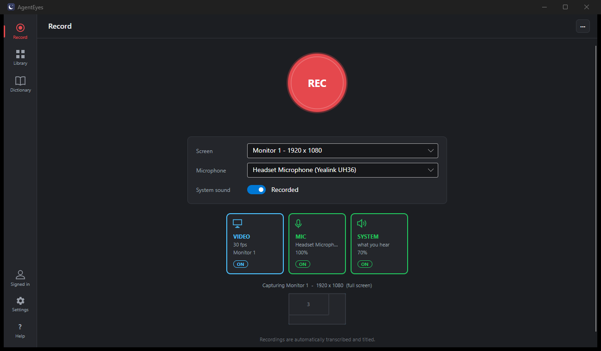
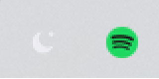
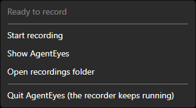

# Issue #116 - QA report, Windows half

| | |
|---|---|
| Machine | **SOREN_NORTH** (Windows 11 Enterprise 10.0.26200, x64), the owner's workstation, in use by him during the run |
| Commit tested | **78a973eeeb642f326175d3a67c7a49d72ebd4d9b** (PR #141 head; it had not moved since the brief) |
| Build identity | read from the binary I ran: `agenteyes.dll` and `AgentEyesDesktop.dll` both embed `+78a973eeeb642f326175d3a67c7a49d72ebd4d9b` (`1.11.11+...` and `1.0.0+...`) |
| SDK | .NET SDK 10.0.403 (net8.0 targets, .NET 8.0.31 runtime) |
| Binary run | `src\AgentEyes.DesktopApp\bin\x64\Release\net8.0-windows10.0.19041.0\AgentEyesDesktop.exe`, built by `dotnet build AgentEyes.sln -c Release` in a fresh worktree |
| Date | 2026-11-16, 06:31 - 06:55 local |
| Raw evidence | `windows-evidence.txt` (build transcripts, linkage counts, every log excerpt, every tray run, test summary) |

## Verdict

**FAIL on Windows: criterion 11 (as amended) does not pass.** The handoff half works: four second launches and
a simultaneous double launch all behaved correctly. But the first instance never exits cleanly. **Quitting from
the tray menu crashes the app every time (3 of 3)** with an unhandled
`System.NotSupportedException: DefaultMenuInteractionHandler is not attached to the menu`. Neither
`[SingleInstance] Dispose` nor `[Program] Main: exited` is ever written. Quit appears only in the tray menu, so on
Windows the app has no clean way to exit.

Criteria 1, 4, 5, 7, 9, 12 (Windows half) and 13 pass. Criterion 10 is reported, as the issue asks. It includes a
second crash route and two other negative findings.

| # | Verdict (Windows) |
|---|---|
| 1 | PASS |
| 4 | PASS |
| 5 | PASS |
| 7 | PASS: gdigrab 2, x11grab 0, with a firing positive control |
| 9 | PASS |
| 10 | REPORTED (a negative finding is a pass for the issue): icon present but hidden and nearly invisible; menu opens and is live; click raises; **closing the menu popup can crash the app** |
| 11 | **FAIL**: handoff PASS; clean first-instance exit FAIL (crash, 3 of 3) |
| 12 | PASS: build 0 errors; test Failed 0, Passed 2297 |
| 13 | PASS: all three jobs green in both runs at 78a973e |

---

## Criterion 1 - the old names are gone

**Expected:** the issue's grep returns no hits outside deliberate historical comments.

**Actual:** exactly the two comments the handoff declared, and `src/AgentEyes.LinuxApp/` does not exist.

```
$ grep -rn "LinuxApp\|AgentEyesLinux" --include "*.cs" --include "*.axaml" --include "*.csproj" --include "*.sh" --include "*.yml" . | grep -v "/bin/\|/obj/\|docs/cencon/proof/"
./scripts/linux/install.sh:113:# running. AgentEyesLinux is the name the app had before issue #116: an install over an older one must
./src/AgentEyes.DesktopApp/AgentEyes.DesktopApp.csproj:4:       first written for Linux as AgentEyes.LinuxApp in issue #107). The window: library, in-app
```

Positive control: the same grep shape finds `AgentEyesDesktop` in 7 files, and `AgentEyes.sln:24` names
`src\AgentEyes.DesktopApp\AgentEyes.DesktopApp.csproj`. So the instrument is not blind.

**Not caught by the grep (observation, not a failure of criterion 1):** the app's settings file is still named
`linux-app.json` (`src/AgentEyes.DesktopApp/Model/AppSettings.cs:23`). On Windows the app created
`%LOCALAPPDATA%\AgentEyes\linux-app.json` the first time it ran. The issue's grep is case-sensitive and does not
match `linux-app`.

## Criterion 4 - Windows builds and opens its window

**Expected:** `Build succeeded.`, `0 Error(s)`; `[MainWindow] Opened` in the app's log with a timestamp; a
screenshot of the window.

**Actual:**

- Criterion 4's own command, `dotnet build src/AgentEyes.DesktopApp -c Release`: `Build succeeded.`,
  `1 Warning(s)`, `0 Error(s)`. **Where it landed:** `bin\Release\net8.0-windows10.0.19041.0\` (Platform AnyCPU),
  which is not the solution build's `bin\x64\Release\...`. Both outputs exist and both link the Windows engine
  (section 3 of the evidence file). Everything below ran the **x64** binary from the solution build.
- Log, `%LOCALAPPDATA%\AgentEyes\logs\AgentEyes-20261116.log`. This is the same file the installed app writes, so
  every excerpt is filtered by pid:

```
06:31:47.527 [pid 64852] [INFO] [Program] Main: AgentEyes desktop app starting on windows (tray=False, pid=64852)
06:31:47.548 [pid 64852] [INFO] [SingleInstance] TryAcquire: listening on pipe agenteyes-app-soren
06:31:57.482 [pid 64852] [INFO] [App] OnFrameworkInitializationCompleted
06:31:57.897 [pid 64852] [INFO] [App] ShowWindow
06:32:16.318 [pid 64852] [INFO] [MainWindow] ctor
06:32:17.546 [pid 64852] [INFO] [MainWindow] Opened
```

- Window screenshot, `windows-window.png`. Taken with **PrintWindow (PW_RENDERFULLCONTENT)** on the window's
  handle, without bringing it forward. 1296x759, 46 distinct sampled colours. I read it: the full Record view
  rendered.



- Window facts from EnumWindows: class `Avalonia-<guid>`, title `AgentEyes`, visible, not hung.
- **UIA can see it.** FrameworkId `Avalonia`, 54 descendants, including `RailRecord`, `RecordButton`/`REC`,
  `CaptureScreenText`, and the device texts. Minor: several buttons expose their UIA Name as
  `Avalonia.Controls.StackPanel` (the rail buttons, Settings, Help). A screen reader would read that text aloud.

**Observation - cold start.** The first launch of a freshly built binary took **41 s** from process start
(06:31:36.57) to `[MainWindow] Opened`: 11 s before `Main` logged, 10 s between taking the pipe and
`OnFrameworkInitializationCompleted` (where `LibVLCSharp.Shared.Core.Initialize()` runs), and 18 s between
`ShowWindow` and the `MainWindow` constructor. Later launches started in about 0.5 s to framework init and about
1 s to the window. Most likely this is a first-run cost (JIT, an antivirus scan of the new libvlc natives).
I did not measure it further.

## Criterion 5 - the solution builds it

**Expected:** `dotnet build AgentEyes.sln -c Release`: `Build succeeded.`, `0 Error(s)`, and `AgentEyesDesktop`
among the built projects.

**Actual:** exit 0, `Build succeeded.`, `22 Warning(s)`, `0 Error(s)`. The line:

```
  AgentEyes.DesktopApp -> <repo>\src\AgentEyes.DesktopApp\bin\x64\Release\net8.0-windows10.0.19041.0\AgentEyesDesktop.dll
```

The same build also produced both engine flavours, `AgentEyes.Core -> ...\bin\x64\Release\net8.0\agenteyes.dll`
and `...\net8.0-windows10.0.19041.0\agenteyes.dll`. The `net8.0` one is used below as the positive control.

## Criterion 7 - Windows links the Windows engine

**Expected:** the built Windows output contains `gdigrab` and does not contain `x11grab`.

**Instrument:** string literals counted as **UTF-16LE**, the CI technique (`ci.yml:62-68`). UTF-8 counts are
shown beside them to show why the encoding matters. The check is paired with a positive control in the same
command: the **Unix** engine, built on this machine in the same solution build.

```
<out>\agenteyes.dll  (the engine the Windows app ships; byte-identical to Core's net8.0-windows build)
   gdigrab       utf16le=2  utf8=0
   x11grab       utf16le=0  utf8=0
   pulse         utf16le=0  utf8=0
   v4l2          utf16le=0  utf8=0
   avfoundation  utf16le=0  utf8=0
   NAudio (UTF-8 assembly reference) = 6
   embedded version: 1.11.11+78a973eeeb642f326175d3a67c7a49d72ebd4d9b

src\AgentEyes.Core\bin\x64\Release\net8.0\agenteyes.dll   (POSITIVE CONTROL - the Unix engine)
   gdigrab       utf16le=2  utf8=0
   x11grab       utf16le=1  utf8=0
   pulse         utf16le=8  utf8=2
   v4l2          utf16le=1  utf8=0
   NAudio = 0
```

**Actual:** PASS. The Windows app's engine has **gdigrab = 2 and x11grab = 0**. The same instrument finds
x11grab = 1 in the Unix engine, so it can fire. As the handoff warned, gdigrab alone does not decide this: the
Unix engine has 2 as well. The deciding presences are x11grab/pulse/v4l2 at 0 plus the NAudio reference at 6.
`libvlc\win-x64\libvlc.dll` is present and there is no `osx-*` folder. `cmp` shows the app's `agenteyes.dll` is
byte-identical to `src\AgentEyes.Core\bin\x64\Release\net8.0-windows10.0.19041.0\agenteyes.dll`.

## Criterion 9 - the app reaches the recorder

**Expected:** a screenshot showing recorder state from the Control API, taken while `GET /health` returns
`ok: true`.

**Actual:** PASS. `windows-window.png` was captured at 06:32:53.970. `GET http://127.0.0.1:7882/health` returned
`{"ok": true, "app": "AgentEyes"}` at 06:32:53.50 (before) and again at 06:32:54.15 (after). The window shows
data that comes from the API: the monitor list (`GetDevicesAsync: 3 monitor(s), 3 mic(s)`), the headset mic,
"Signed in", and an enabled REC. The log shows `[AppState] PollAsync: service answering, state=idle`, and the
tray menu's status line read "Ready to record" (criterion 10).

The recorder it reached is the **owner's installed app** (pid 26652). `ControlClient.BaseUrl` is a constant,
`http://127.0.0.1:7882` (`Services/ControlClient.cs:41`), so the app cannot be pointed at a separate
`agenteyes serve --port 7894`. I read the code before launching: at startup it only GETs `/status` and
`/devices`; every write (`/record/start`, rename, delete, ...) needs a click, and I made none. Related: the
offline message at `ControlClient.cs:133` tells the user to run `systemctl --user start agenteyes` on every
platform, which is Linux-only advice on Windows.

## Criterion 10 - the tray icon, as it actually behaves on Windows

A negative finding here is a pass for the issue, so this section reports everything.

| Question | Result |
|---|---|
| Does the icon appear? | **Yes, but hidden by default and nearly invisible.** It is registered with the shell (`HKCU\Control Panel\NotifyIconSettings` has an entry for `AgentEyesDesktop.exe`, not promoted). It sits in the **overflow** ("Show Hidden Icons"), not on the taskbar. The idle icon is an off-white crescent on Windows 11's light-grey flyout: centre pixel (217,218,221) against background (217,219,222). `windows-tray-icon-zoom.png` is 4x. The installed WPF app's icon is the dark moon on the taskbar in the same screenshot. |
| Does its menu open? | **Yes.** All five entries are present, and the status line is live ("Ready to record"). The menu is an Avalonia popup window, not a native Win32 menu. `windows-tray-menu.png` is PrintWindow of that popup. |
| Does a click raise the window? | **Yes.** Window closed to tray (`[App] window closed to the tray`, window not visible), then the overflow icon was activated: `[App] ShowWindow` and `[MainWindow] Opened` at 06:36:48. The window became visible **and** the foreground window. |
| "Show AgentEyes" in the menu | **Not verified.** UIA cannot activate the menu items (next row). I posted a click to the Quit item only. |
| Can UIA drive the menu? | **No.** The menu items expose only `ScrollItemPattern`, no `InvokePattern` (`GetCurrentPattern(InvokePattern)` throws "Unsupported Pattern"). |
| Can closing the menu crash the app? | **Yes, sometimes.** Closing the menu popup window with UIA `WindowPattern.Close` crashed the app with the same `NotSupportedException` as criterion 11, in **2 of 6** attempts. Both crashes came after a longer sequence: window shown, then hidden to tray, then the menu opened twice with UIA walking its items, then Close. Opening once and then closing with UIA (2 runs), WM_CLOSE (1 run) or WM_CLOSE after a double open (1 run) did not crash. I did not isolate the minimal steps. All runs are in section 10 of the evidence file. |

 



**How the tray was driven, without synthesizing input at the cursor:**

- The overflow was opened, and the icon left-clicked, with **UIA InvokePattern** on Explorer's own tray buttons.
- The menu was opened with the shell's own notification to the app: `PostMessage` to the app's
  `AvaloniaMessageWindow` of `WM_TRAYMOUSE` (0x800, read by reflection from
  `Avalonia.Win32.TrayIconImpl+CustomWindowsMessage`), `wParam` = icon id 1, `lParam` = `WM_RBUTTONUP`. That is
  the message Explorer sends on a right-click. The channel was confirmed first: posting `WM_LBUTTONUP` on it
  logged `[App] ShowWindow`, and other window/id combinations logged nothing.
- Quit was clicked with `PostMessage` of `WM_MOUSEMOVE`/`WM_LBUTTONDOWN`/`WM_LBUTTONUP` to the menu popup's own
  window at the Quit item's client point, taken from its UIA bounding rectangle.
- **Not done:** a physical mouse click on the icon. The left/right mapping to these events is Explorer's, so I
  expect a physical click to behave the same, but I did not observe one.

## Criterion 11 - single instance (as amended: the first instance must also exit cleanly)

### Handoff: PASS

Second launch while the first runs (four times, each with a distinct command):

```
06:33:16.236 [pid 38292] [INFO] [Program] Main: AgentEyes desktop app starting on windows (tray=False, pid=38292)
06:33:16.240 [pid 38292] [INFO] [SingleInstance] TryAcquirePipe: agenteyes-app-soren command='view:library'
06:33:16.245 [pid 38292] [INFO] [SingleInstance] TryAcquire: pipe agenteyes-app-soren is owned by another instance (UnauthorizedAccessException: Access to the path is denied.)
06:33:16.246 [pid 38292] [INFO] [SingleInstance] TryAcquire: another instance is running - sent it 'view:library'
06:33:16.247 [pid 64852] [INFO] [SingleInstance] Accept: 'view:library'
06:33:16.247 [pid 64852] [INFO] [App] Run: view:library
06:33:16.247 [pid 64852] [INFO] [App] ShowWindow
06:33:16.258 [pid 64852] [INFO] [MainWindow] RunCommand: view library
06:33:16.261 [pid 64852] [INFO] [MainWindow] Rail_Changed: Library
```

- pid 10600 (`--view record`, run directly so its exit code could be read): **exit 0**, and the first instance
  switched to Record. After each second launch, `tasklist` showed exactly one `AgentEyesDesktop.exe`.
- `UnauthorizedAccessException` is how a `FirstPipeInstance` claim fails when the name is taken. It is expected.
- **Simultaneous launch** (`start A --tray & start B --tray` on one cmd line): 20716 claimed the pipe at
  .515; 16536 (started 5 ms later) found it owned at .523, handed off `'tray'` and exited. **Exactly one survived**
  after 10 s. This is the `FirstPipeInstance` claim the handoff said no Linux test can prove.
- **Raise, measured by z-order** (non-topmost, visible, titled windows):
  - Window pushed to the bottom with `SetWindowPos(HWND_BOTTOM, SWP_NOACTIVATE)`, rank **#19**. After a second
    launch it was at **#2**, directly under the window the owner was using. It was raised in the z-order but not
    activated, which is what Windows' foreground lock does when a background process asks for focus. The second
    process does not call `AllowSetForegroundWindow` for the first (no hit in `src/AgentEyes.DesktopApp`).
    Whether a launch from Explorer (which holds foreground rights) would activate it is unmeasured.
  - Window minimized (`SW_SHOWMINNOACTIVE`). After a second launch it was restored **and became the foreground
    window**, rank #1.
  - I count this as raising.

### Clean exit of the first instance: FAIL

**Expected (amendment):** `[SingleInstance] Dispose:` and `[Program] Main: exited` appear, and the pipe is gone
afterwards.

**Actual:** Quit through the tray menu crashed the app in **3 of 3** runs: 31720 (after earlier tray use), 53000
(a **fresh** `--tray` instance, menu opened once, Quit clicked) and 20716 (a fresh instance, the survivor of the
race). In all three:

```
06:47:07.467 [pid 53000] [INFO] [App] Quit (the recorder service keeps running)
06:47:07.504 [pid 53000] [ERROR] [Program] unhandled exception - the app is going down
06:47:07.504 [pid 53000] [ERROR] System.NotSupportedException: DefaultMenuInteractionHandler is not attached to the menu.
   at Avalonia.Controls.Platform.DefaultMenuInteractionHandler.DetachCore(IMenu menu)
   at Avalonia.Controls.Platform.DefaultMenuInteractionHandler.Detach(MenuBase menu)
   at Avalonia.Controls.MenuBase.OnDetachedFromVisualTree(VisualTreeAttachmentEventArgs e)
   at Avalonia.Controls.MenuFlyoutPresenter.OnDetachedFromVisualTree(VisualTreeAttachmentEventArgs e)
   ... (OnDetachedFromVisualTreeCore frames) ...
   at Avalonia.Controls.TopLevel.HandleClosed()
   at Avalonia.Controls.Window.HandleClosed()
   at Avalonia.Win32.WindowImpl.AppWndProc(...)
   at Avalonia.Win32.WindowImpl.WndProcMessageHandler(...)
```

- No `[SingleInstance] Dispose` and no `[Program] Main: exited` for any of the five first instances that ended in
  this session (64852, 24704, 31720, 53000, 20716; grep count 0). Every one of them ended in this crash. The Windows Application log has a .NET Runtime event 1026 with the same exception for
  each of the 5 crashes, and WerFault took a dump each time. That dump is why 31720 and 53000 were still alive
  15 s and 5 s after the click.
- The pipe **is** gone afterwards (`agenteyes-app-soren present=False`; the instrument listed 1290 pipes). But it
  is gone only because the process died, not because `Dispose` ran. The amendment asks for a presence: the
  Dispose and exit lines. Those are absent.

**Where:** the trigger is `TrayController.cs:46-48` (the Quit `NativeMenuItem.Click`) calling `App.Quit`
(`src/AgentEyes.DesktopApp/App.axaml.cs:95-101`), which runs `_window?.Close()` and then `desktop.Shutdown()`
**synchronously, inside the menu's own click handling**. The throw happens in Avalonia's `WndProc` while the
tray-menu popup (`MenuFlyoutPresenter`) is torn down. No AgentEyes frame is on the stack, so the link to `Quit`
rests on timing (37 to 360 ms after `[App] Quit`, every time) and the code path, not on a frame. The exception
escapes the message loop, so the `finally` at `Program.cs:47-51` that would call `Instance.Dispose()` and log
`Main: exited` never runs.

On Linux the menu is exported over D-Bus (dbusmenu), not drawn as an Avalonia popup, which fits Linux passing
4 of 4. **Hypothesis only, not tested:** posting the shutdown to run after the menu has closed
(`Dispatcher.UIThread.Post(...)`) may avoid it. The criterion 10 crash (closing the popup) has the same exception
and stack, so the two may share a root cause.

## Criterion 12 - gates, Windows half (SOREN_NORTH)

- `dotnet build AgentEyes.sln -c Release`: `Build succeeded.`, `0 Error(s)` (criterion 5).
- `dotnet test AgentEyes.sln -c Release`, 06:48:19 - 06:53:07, exit 0:

```
Passed!  - Failed:     0, Passed:  2297, Skipped:     0, Total:  2297, Duration: 1 m 16 s - AgentEyes.Tests.dll (net8.0)
```

**Coverage note:** the only test project in `AgentEyes.sln` is `tests/AgentEyes.Tests`. The DesktopApp tests,
including `TryAcquirePipe_SecondLaunch_...`, live in `tests/AgentEyes.Tests.Linux`, which the Windows gate does
not build. So the Windows gate runs **no** DesktopApp test, and the named-pipe code has never been unit-tested on
Windows (the handoff says this too). Nothing in it would have caught the Quit crash.

## Criterion 13 - CI

Both runs at `78a973eeeb642f326175d3a67c7a49d72ebd4d9b` are green on all three jobs, including the renamed
project's steps:

- pull_request: https://github.com/thefrederiksen/agenteyes-app/actions/runs/43730275492
- push: https://github.com/thefrederiksen/agenteyes-app/actions/runs/43730267378

`linux`: "Build the desktop app (Linux)" and "The Linux desktop app must link the Linux engine" succeeded.
`macos`: "Build the desktop app (macOS)" and "...must link the macOS engine and carry libvlc" succeeded.
`windows`: "The Windows desktop app must link the Windows engine" succeeded.

CI only builds and checks linkage. It never launches the app, which is how the Quit crash passed CI.

---

## Safety, and what I did on the owner's machine

- **Hazard checks.** Before the suite, `GET /status` = `idle`, no `*.muxing.tmp` anywhere under
  `%USERPROFILE%\Videos\AgentEyes`, and 0 ffmpeg processes. **The owner started a recording at 06:49:36, about a
  minute into the 5-minute test run** (the #151 overlap). I found it straight after the suite finished. His
  ffmpeg (pid 33868) survived: `/status` = `recording` with ElapsedSeconds 299.72, and `raw.mp4` grew 262 KB in
  6 s. I did not touch it. I did not need to wait, because he was idle when I checked. #151 remains a real risk:
  a check at the start of a run does not protect the rest of the run.
- **No ffmpeg killed. No recording, preset or audio setting touched. The installed app (pid 26652) was left
  running**, with `/health` `ok: true` throughout.
- **Focus.** Twice the window under test took the foreground on purpose, because that is the behaviour being
  measured: the minimized-raise test at 06:34:35 and the tray-click raise at 06:36:48. Each time this took focus
  from whatever the owner had open. One tray-menu popup stayed open on his second monitor for about 45 s
  (06:38:41 - 06:39:23) after a failed UIA attempt; I closed it with UIA, which caused the first crash.
- **Files the app under test created:** `%LOCALAPPDATA%\AgentEyes\linux-app.json`, saved by the app itself, and
  five Windows Error Reporting reports for `AgentEyesDesktop.exe`. My builds are in a separate worktree. Nothing
  was installed.
- Every `AgentEyesDesktop.exe` process I started has ended (`tasklist` count 0 at the end).

## What I did NOT cover

- **macOS and Linux** (out of scope), the installer, and SORENLAPTOP.
- **Any recording from the new app.** REC and "Start recording" were never pressed: the app can only drive the
  owner's live recorder on 7882. So recording, stop/mux, playback, rename, delete, subtitles and walkthrough from
  this app on Windows are unverified.
- The Library, Dictionary, Settings, Detail and Player windows beyond the Library switch. "Open recordings
  folder" (`Shell.cs`, `explorer`) and "Show AgentEyes" from the menu were not exercised.
- A **physical** mouse click on the tray icon (UIA Invoke and the shell's callback message were used instead),
  and closing the menu with Escape or a click elsewhere.
- The minimal steps for the criterion 10 popup-close crash. It is reproduced 2 of 2 on the long sequence and 0 of
  4 on shorter ones.
- Whether the 41 s cold start repeats on another machine or after a reboot.
- A fix. QA does not implement.
