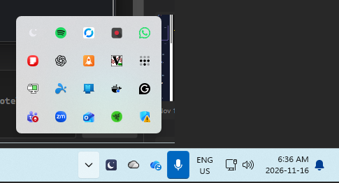

# Issue #116 - QA report, Windows half

| | |
|---|---|
| Machine | **SOREN_NORTH** (Windows 11 Enterprise 10.0.26200, x64), the owner's workstation, in use by him during the run |
| Commit tested | **78a973eeeb642f326175d3a67c7a49d72ebd4d9b** (PR #141 head; it had not moved since the brief) |
| Build identity | read from the binary I ran: `agenteyes.dll` and `AgentEyesDesktop.dll` both embed `+78a973eeeb642f326175d3a67c7a49d72ebd4d9b` (`1.11.11+...` and `1.0.0+...`) |
| SDK | .NET SDK 10.0.403 (net8.0 targets, .NET 8.0.31 runtime) |
| Binary run | `src\AgentEyes.DesktopApp\bin\x64\Release\net8.0-windows10.0.19041.0\AgentEyesDesktop.exe`, built by `dotnet build AgentEyes.sln -c Release` in a fresh worktree |
| Date | 2026-11-16, 06:31 - 06:55 local |
| Raw evidence | `windows-evidence.txt` (build transcripts, linkage counts, every log excerpt, every tray run, test summary) |

## Verdict

**FAIL on Windows: criterion 11 (as amended) does not pass.** The handoff half works: four second launches and
a simultaneous double launch all behaved correctly. But the first instance never exits cleanly. **Quitting from
the tray menu crashes the app every time (3 of 3)** with an unhandled
`System.NotSupportedException: DefaultMenuInteractionHandler is not attached to the menu`. Neither
`[SingleInstance] Dispose` nor `[Program] Main: exited` is ever written. Quit appears only in the tray menu, so on
Windows the app has no clean way to exit.

Criteria 1, 4, 5, 7, 9, 12 (Windows half) and 13 pass. Criterion 10 is reported, as the issue asks. It includes a
second crash route and two other negative findings.

| # | Verdict (Windows) |
|---|---|
| 1 | PASS |
| 4 | PASS |
| 5 | PASS |
| 7 | PASS: gdigrab 2, x11grab 0, with a firing positive control |
| 9 | PASS |
| 10 | REPORTED (a negative finding is a pass for the issue): icon present but hidden and nearly invisible; menu opens and is live; click raises; **closing the menu popup can crash the app** |
| 11 | **FAIL**: handoff PASS; clean first-instance exit FAIL (crash, 3 of 3) |
| 12 | PASS: build 0 errors; test Failed 0, Passed 2297 |
| 13 | PASS: all three jobs green in both runs at 78a973e |

---

## Criterion 1 - the old names are gone

**Expected:** the issue's grep returns no hits outside deliberate historical comments.

**Actual:** exactly the two comments the handoff declared, and `src/AgentEyes.LinuxApp/` does not exist.

```
$ grep -rn "LinuxApp\|AgentEyesLinux" --include "*.cs" --include "*.axaml" --include "*.csproj" --include "*.sh" --include "*.yml" . | grep -v "/bin/\|/obj/\|docs/cencon/proof/"
./scripts/linux/install.sh:113:# running. AgentEyesLinux is the name the app had before issue #116: an install over an older one must
./src/AgentEyes.DesktopApp/AgentEyes.DesktopApp.csproj:4:       first written for Linux as AgentEyes.LinuxApp in issue #107). The window: library, in-app
```

Positive control: the same grep shape finds `AgentEyesDesktop` in 7 files, and `AgentEyes.sln:24` names
`src\AgentEyes.DesktopApp\AgentEyes.DesktopApp.csproj`. So the instrument is not blind.

**Not caught by the grep (observation, not a failure of criterion 1):** the app's settings file is still named
`linux-app.json` (`src/AgentEyes.DesktopApp/Model/AppSettings.cs:23`). On Windows the app created
`%LOCALAPPDATA%\AgentEyes\linux-app.json` the first time it ran. The issue's grep is case-sensitive and does not
match `linux-app`.

## Criterion 4 - Windows builds and opens its window

**Expected:** `Build succeeded.`, `0 Error(s)`; `[MainWindow] Opened` in the app's log with a timestamp; a
screenshot of the window.

**Actual:**

- Criterion 4's own command, `dotnet build src/AgentEyes.DesktopApp -c Release`: `Build succeeded.`,
  `1 Warning(s)`, `0 Error(s)`. **Where it landed:** `bin\Release\net8.0-windows10.0.19041.0\` (Platform AnyCPU),
  which is not the solution build's `bin\x64\Release\...`. Both outputs exist and both link the Windows engine
  (section 3 of the evidence file). Everything below ran the **x64** binary from the solution build.
- Log, `%LOCALAPPDATA%\AgentEyes\logs\AgentEyes-20261116.log`. This is the same file the installed app writes, so
  every excerpt is filtered by pid:

```
06:31:47.527 [pid 64852] [INFO] [Program] Main: AgentEyes desktop app starting on windows (tray=False, pid=64852)
06:31:47.548 [pid 64852] [INFO] [SingleInstance] TryAcquire: listening on pipe agenteyes-app-soren
06:31:57.482 [pid 64852] [INFO] [App] OnFrameworkInitializationCompleted
06:31:57.897 [pid 64852] [INFO] [App] ShowWindow
06:32:16.318 [pid 64852] [INFO] [MainWindow] ctor
06:32:17.546 [pid 64852] [INFO] [MainWindow] Opened
```

- Window screenshot, `windows-window.png`. Taken with **PrintWindow (PW_RENDERFULLCONTENT)** on the window's
  handle, without bringing it forward. 1296x759, 46 distinct sampled colours. I read it: the full Record view
  rendered.


- Window facts from EnumWindows: class `Avalonia-<guid>`, title `AgentEyes`, visible, not hung.
- **UIA can see it.** FrameworkId `Avalonia`, 54 descendants, including `RailRecord`, `RecordButton`/`REC`,
  `CaptureScreenText`, and the device texts. Minor: several buttons expose their UIA Name as
  `Avalonia.Controls.StackPanel` (the rail buttons, Settings, Help). A screen reader would read that text aloud.

**Observation - cold start.** The first launch of a freshly built binary took **41 s** from process start
(06:31:36.57) to `[MainWindow] Opened`: 11 s before `Main` logged, 10 s between taking the pipe and
`OnFrameworkInitializationCompleted` (where `LibVLCSharp.Shared.Core.Initialize()` runs), and 18 s between
`ShowWindow` and the `MainWindow` constructor. Later launches started in about 0.5 s to framework init and about
1 s to the window. Most likely this is a first-run cost (JIT, an antivirus scan of the new libvlc natives).
I did not measure it further.

## Criterion 5 - the solution builds it

**Expected:** `dotnet build AgentEyes.sln -c Release`: `Build succeeded.`, `0 Error(s)`, and `AgentEyesDesktop`
among the built projects.

**Actual:** exit 0, `Build succeeded.`, `22 Warning(s)`, `0 Error(s)`. The line:

```
  AgentEyes.DesktopApp -> <repo>\src\AgentEyes.DesktopApp\bin\x64\Release\net8.0-windows10.0.19041.0\AgentEyesDesktop.dll
```

The same build also produced both engine flavours, `AgentEyes.Core -> ...\bin\x64\Release\net8.0\agenteyes.dll`
and `...\net8.0-windows10.0.19041.0\agenteyes.dll`. The `net8.0` one is used below as the positive control.

## Criterion 7 - Windows links the Windows engine

**Expected:** the built Windows output contains `gdigrab` and does not contain `x11grab`.

**Instrument:** string literals counted as **UTF-16LE**, the CI technique (`ci.yml:62-68`). UTF-8 counts are
shown beside them to show why the encoding matters. The check is paired with a positive control in the same
command: the **Unix** engine, built on this machine in the same solution build.

```
<out>\agenteyes.dll  (the engine the Windows app ships; byte-identical to Core's net8.0-windows build)
   gdigrab       utf16le=2  utf8=0
   x11grab       utf16le=0  utf8=0
   pulse         utf16le=0  utf8=0
   v4l2          utf16le=0  utf8=0
   avfoundation  utf16le=0  utf8=0
   NAudio (UTF-8 assembly reference) = 6
   embedded version: 1.11.11+78a973eeeb642f326175d3a67c7a49d72ebd4d9b

src\AgentEyes.Core\bin\x64\Release\net8.0\agenteyes.dll   (POSITIVE CONTROL - the Unix engine)
   gdigrab       utf16le=2  utf8=0
   x11grab       utf16le=1  utf8=0
   pulse         utf16le=8  utf8=2
   v4l2          utf16le=1  utf8=0
   NAudio = 0
```

**Actual:** PASS. The Windows app's engine has **gdigrab = 2 and x11grab = 0**. The same instrument finds
x11grab = 1 in the Unix engine, so it can fire. As the handoff warned, gdigrab alone does not decide this: the
Unix engine has 2 as well. The deciding presences are x11grab/pulse/v4l2 at 0 plus the NAudio reference at 6.
`libvlc\win-x64\libvlc.dll` is present and there is no `osx-*` folder. `cmp` shows the app's `agenteyes.dll` is
byte-identical to `src\AgentEyes.Core\bin\x64\Release\net8.0-windows10.0.19041.0\agenteyes.dll`.

## Criterion 9 - the app reaches the recorder

**Expected:** a screenshot showing recorder state from the Control API, taken while `GET /health` returns
`ok: true`.

**Actual:** PASS. `windows-window.png` was captured at 06:32:53.970. `GET http://127.0.0.1:7882/health` returned
`{"ok": true, "app": "AgentEyes"}` at 06:32:53.50 (before) and again at 06:32:54.15 (after). The window shows
data that comes from the API: the monitor list (`GetDevicesAsync: 3 monitor(s), 3 mic(s)`), the headset mic,
"Signed in", and an enabled REC. The log shows `[AppState] PollAsync: service answering, state=idle`, and the
tray menu's status line read "Ready to record" (criterion 10).

The recorder it reached is the **owner's installed app** (pid 26652). `ControlClient.BaseUrl` is a constant,
`http://127.0.0.1:7882` (`Services/ControlClient.cs:41`), so the app cannot be pointed at a separate
`agenteyes serve --port 7894`. I read the code before launching: at startup it only GETs `/status` and
`/devices`; every write (`/record/start`, rename, delete, ...) needs a click, and I made none. Related: the
offline message at `ControlClient.cs:133` tells the user to run `systemctl --user start agenteyes` on every
platform, which is Linux-only advice on Windows.

## Criterion 10 - the tray icon, as it actually behaves on Windows

A negative finding here is a pass for the issue, so this section reports everything.

| Question | Result |
|---|---|
| Does the icon appear? | **Yes, but hidden by default and nearly invisible.** It is registered with the shell (`HKCU\Control Panel\NotifyIconSettings` has an entry for `AgentEyesDesktop.exe`, not promoted). It sits in the **overflow** ("Show Hidden Icons"), not on the taskbar. The idle icon is an off-white crescent on Windows 11's light-grey flyout: centre pixel (217,218,221) against background (217,219,222). `windows-tray-icon-zoom.png` is 4x. The installed WPF app's icon is the dark moon on the taskbar in the same screenshot. |
| Does its menu open? | **Yes.** All five entries are present, and the status line is live ("Ready to record"). The menu is an Avalonia popup window, not a native Win32 menu. `windows-tray-menu.png` is PrintWindow of that popup. |
| Does a click raise the window? | **Yes.** Window closed to tray (`[App] window closed to the tray`, window not visible), then the overflow icon was activated: `[App] ShowWindow` and `[MainWindow] Opened` at 06:36:48. The window became visible **and** the foreground window. |
| "Show AgentEyes" in the menu | **Not verified.** UIA cannot activate the menu items (next row). I posted a click to the Quit item only. |
| Can UIA drive the menu? | **No.** The menu items expose only `ScrollItemPattern`, no `InvokePattern` (`GetCurrentPattern(InvokePattern)` throws "Unsupported Pattern"). |
| Can closing the menu crash the app? | **Yes, sometimes.** Closing the menu popup window with UIA `WindowPattern.Close` crashed the app with the same `NotSupportedException` as criterion 11, in **2 of 6** attempts. Both crashes came after a longer sequence: window shown, then hidden to tray, then the menu opened twice with UIA walking its items, then Close. Opening once and then closing with UIA (2 runs), WM_CLOSE (1 run) or WM_CLOSE after a double open (1 run) did not crash. I did not isolate the minimal steps. All runs are in section 10 of the evidence file. |

 


**How the tray was driven, without synthesizing input at the cursor:**

- The overflow was opened, and the icon left-clicked, with **UIA InvokePattern** on Explorer's own tray buttons.
- The menu was opened with the shell's own notification to the app: `PostMessage` to the app's
  `AvaloniaMessageWindow` of `WM_TRAYMOUSE` (0x800, read by reflection from
  `Avalonia.Win32.TrayIconImpl+CustomWindowsMessage`), `wParam` = icon id 1, `lParam` = `WM_RBUTTONUP`. That is
  the message Explorer sends on a right-click. The channel was confirmed first: posting `WM_LBUTTONUP` on it
  logged `[App] ShowWindow`, and other window/id combinations logged nothing.
- Quit was clicked with `PostMessage` of `WM_MOUSEMOVE`/`WM_LBUTTONDOWN`/`WM_LBUTTONUP` to the menu popup's own
  window at the Quit item's client point, taken from its UIA bounding rectangle.
- **Not done:** a physical mouse click on the icon. The left/right mapping to these events is Explorer's, so I
  expect a physical click to behave the same, but I did not observe one.

## Criterion 11 - single instance (as amended: the first instance must also exit cleanly)

### Handoff: PASS

Second launch while the first runs (four times, each with a distinct command):

```
06:33:16.236 [pid 38292] [INFO] [Program] Main: AgentEyes desktop app starting on windows (tray=False, pid=38292)
06:33:16.240 [pid 38292] [INFO] [SingleInstance] TryAcquirePipe: agenteyes-app-soren command='view:library'
06:33:16.245 [pid 38292] [INFO] [SingleInstance] TryAcquire: pipe agenteyes-app-soren is owned by another instance (UnauthorizedAccessException: Access to the path is denied.)
06:33:16.246 [pid 38292] [INFO] [SingleInstance] TryAcquire: another instance is running - sent it 'view:library'
06:33:16.247 [pid 64852] [INFO] [SingleInstance] Accept: 'view:library'
06:33:16.247 [pid 64852] [INFO] [App] Run: view:library
06:33:16.247 [pid 64852] [INFO] [App] ShowWindow
06:33:16.258 [pid 64852] [INFO] [MainWindow] RunCommand: view library
06:33:16.261 [pid 64852] [INFO] [MainWindow] Rail_Changed: Library
```

- pid 10600 (`--view record`, run directly so its exit code could be read): **exit 0**, and the first instance
  switched to Record. After each second launch, `tasklist` showed exactly one `AgentEyesDesktop.exe`.
- `UnauthorizedAccessException` is how a `FirstPipeInstance` claim fails when the name is taken. It is expected.
- **Simultaneous launch** (`start A --tray & start B --tray` on one cmd line): 20716 claimed the pipe at
  .515; 16536 (started 5 ms later) found it owned at .523, handed off `'tray'` and exited. **Exactly one survived**
  after 10 s. This is the `FirstPipeInstance` claim the handoff said no Linux test can prove.
- **Raise, measured by z-order** (non-topmost, visible, titled windows):
  - Window pushed to the bottom with `SetWindowPos(HWND_BOTTOM, SWP_NOACTIVATE)`, rank **#19**. After a second
    launch it was at **#2**, directly under the window the owner was using. It was raised in the z-order but not
    activated, which is what Windows' foreground lock does when a background process asks for focus. The second
    process does not call `AllowSetForegroundWindow` for the first (no hit in `src/AgentEyes.DesktopApp`).
    Whether a launch from Explorer (which holds foreground rights) would activate it is unmeasured.
  - Window minimized (`SW_SHOWMINNOACTIVE`). After a second launch it was restored **and became the foreground
    window**, rank #1.
  - I count this as raising.

### Clean exit of the first instance: FAIL

**Expected (amendment):** `[SingleInstance] Dispose:` and `[Program] Main: exited` appear, and the pipe is gone
afterwards.

**Actual:** Quit through the tray menu crashed the app in **3 of 3** runs: 31720 (after earlier tray use), 53000
(a **fresh** `--tray` instance, menu opened once, Quit clicked) and 20716 (a fresh instance, the survivor of the
race). In all three:

```
06:47:07.467 [pid 53000] [INFO] [App] Quit (the recorder service keeps running)
06:47:07.504 [pid 53000] [ERROR] [Program] unhandled exception - the app is going down
06:47:07.504 [pid 53000] [ERROR] System.NotSupportedException: DefaultMenuInteractionHandler is not attached to the menu.
   at Avalonia.Controls.Platform.DefaultMenuInteractionHandler.DetachCore(IMenu menu)
   at Avalonia.Controls.Platform.DefaultMenuInteractionHandler.Detach(MenuBase menu)
   at Avalonia.Controls.MenuBase.OnDetachedFromVisualTree(VisualTreeAttachmentEventArgs e)
   at Avalonia.Controls.MenuFlyoutPresenter.OnDetachedFromVisualTree(VisualTreeAttachmentEventArgs e)
   ... (OnDetachedFromVisualTreeCore frames) ...
   at Avalonia.Controls.TopLevel.HandleClosed()
   at Avalonia.Controls.Window.HandleClosed()
   at Avalonia.Win32.WindowImpl.AppWndProc(...)
   at Avalonia.Win32.WindowImpl.WndProcMessageHandler(...)
```

- No `[SingleInstance] Dispose` and no `[Program] Main: exited` for any of the five first instances that ended in
  this session (64852, 24704, 31720, 53000, 20716; grep count 0). Every one of them ended in this crash. The Windows Application log has a .NET Runtime event 1026 with the same exception for
  each of the 5 crashes, and WerFault took a dump each time. That dump is why 31720 and 53000 were still alive
  15 s and 5 s after the click.
- The pipe **is** gone afterwards (`agenteyes-app-soren present=False`; the instrument listed 1290 pipes). But it
  is gone only because the process died, not because `Dispose` ran. The amendment asks for a presence: the
  Dispose and exit lines. Those are absent.

**Where:** the trigger is `TrayController.cs:46-48` (the Quit `NativeMenuItem.Click`) calling `App.Quit`
(`src/AgentEyes.DesktopApp/App.axaml.cs:95-101`), which runs `_window?.Close()` and then `desktop.Shutdown()`
**synchronously, inside the menu's own click handling**. The throw happens in Avalonia's `WndProc` while the
tray-menu popup (`MenuFlyoutPresenter`) is torn down. No AgentEyes frame is on the stack, so the link to `Quit`
rests on timing (37 to 360 ms after `[App] Quit`, every time) and the code path, not on a frame. The exception
escapes the message loop, so the `finally` at `Program.cs:47-51` that would call `Instance.Dispose()` and log
`Main: exited` never runs.

On Linux the menu is exported over D-Bus (dbusmenu), not drawn as an Avalonia popup, which fits Linux passing
4 of 4. **Hypothesis only, not tested:** posting the shutdown to run after the menu has closed
(`Dispatcher.UIThread.Post(...)`) may avoid it. The criterion 10 crash (closing the popup) has the same exception
and stack, so the two may share a root cause.

## Criterion 12 - gates, Windows half (SOREN_NORTH)

- `dotnet build AgentEyes.sln -c Release`: `Build succeeded.`, `0 Error(s)` (criterion 5).
- `dotnet test AgentEyes.sln -c Release`, 06:48:19 - 06:53:07, exit 0:

```
Passed!  - Failed:     0, Passed:  2297, Skipped:     0, Total:  2297, Duration: 1 m 16 s - AgentEyes.Tests.dll (net8.0)
```

**Coverage note:** the only test project in `AgentEyes.sln` is `tests/AgentEyes.Tests`. The DesktopApp tests,
including `TryAcquirePipe_SecondLaunch_...`, live in `tests/AgentEyes.Tests.Linux`, which the Windows gate does
not build. So the Windows gate runs **no** DesktopApp test, and the named-pipe code has never been unit-tested on
Windows (the handoff says this too). Nothing in it would have caught the Quit crash.

## Criterion 13 - CI

Both runs at `78a973eeeb642f326175d3a67c7a49d72ebd4d9b` are green on all three jobs, including the renamed
project's steps:

- pull_request: https://github.com/thefrederiksen/agenteyes-app/actions/runs/43730275492
- push: https://github.com/thefrederiksen/agenteyes-app/actions/runs/43730267378

`linux`: "Build the desktop app (Linux)" and "The Linux desktop app must link the Linux engine" succeeded.
`macos`: "Build the desktop app (macOS)" and "...must link the macOS engine and carry libvlc" succeeded.
`windows`: "The Windows desktop app must link the Windows engine" succeeded.

CI only builds and checks linkage. It never launches the app, which is how the Quit crash passed CI.

---

## Safety, and what I did on the owner's machine

- **Hazard checks.** Before the suite, `GET /status` = `idle`, no `*.muxing.tmp` anywhere under
  `%USERPROFILE%\Videos\AgentEyes`, and 0 ffmpeg processes. **The owner started a recording at 06:49:36, about a
  minute into the 5-minute test run** (the #151 overlap). I found it straight after the suite finished. His
  ffmpeg (pid 33868) survived: `/status` = `recording` with ElapsedSeconds 299.72, and `raw.mp4` grew 262 KB in
  6 s. I did not touch it. I did not need to wait, because he was idle when I checked. #151 remains a real risk:
  a check at the start of a run does not protect the rest of the run.
- **No ffmpeg killed. No recording, preset or audio setting touched. The installed app (pid 26652) was left
  running**, with `/health` `ok: true` throughout.
- **Focus.** Twice the window under test took the foreground on purpose, because that is the behaviour being
  measured: the minimized-raise test at 06:34:35 and the tray-click raise at 06:36:48. Each time this took focus
  from whatever the owner had open. One tray-menu popup stayed open on his second monitor for about 45 s
  (06:38:41 - 06:39:23) after a failed UIA attempt; I closed it with UIA, which caused the first crash.
- **Files the app under test created:** `%LOCALAPPDATA%\AgentEyes\linux-app.json`, saved by the app itself, and
  five Windows Error Reporting reports for `AgentEyesDesktop.exe`. My builds are in a separate worktree. Nothing
  was installed.
- Every `AgentEyesDesktop.exe` process I started has ended (`tasklist` count 0 at the end).

## What I did NOT cover

- **macOS and Linux** (out of scope), the installer, and SORENLAPTOP.
- **Any recording from the new app.** REC and "Start recording" were never pressed: the app can only drive the
  owner's live recorder on 7882. So recording, stop/mux, playback, rename, delete, subtitles and walkthrough from
  this app on Windows are unverified.
- The Library, Dictionary, Settings, Detail and Player windows beyond the Library switch. "Open recordings
  folder" (`Shell.cs`, `explorer`) and "Show AgentEyes" from the menu were not exercised.
- A **physical** mouse click on the tray icon (UIA Invoke and the shell's callback message were used instead),
  and closing the menu with Escape or a click elsewhere.
- The minimal steps for the criterion 10 popup-close crash. It is reproduced 2 of 2 on the long sequence and 0 of
  4 on shorter ones.
- Whether the 41 s cold start repeats on another machine or after a reboot.
- A fix. QA does not implement.

---

# Windows QA pass 3 - the tray Quit guard (TrayPopupCloseGuard + DeferredQuit)

| | |
|---|---|
| Machine | **SOREN_NORTH** (Windows 11 Enterprise 10.0.26200, x64), the owner's workstation |
| Head tested | PR #141 branch `issue-116-desktop-app` at **02b6f3725cfc7fbfcde182f83a2c959678fca19e** (the handoff commit). `git diff e5ce76c 02b6f37` touches only `handoff.md` (5 lines), so the code under test is **e5ce76c** |
| Embedded commit, read from the binary I ran | `AgentEyesDesktop.exe` and `AgentEyesDesktop.dll` ProductVersion `1.0.0+02b6f3725cfc7fbfcde182f83a2c959678fca19e`; `agenteyes.dll` `1.11.11+02b6f3725cfc7fbfcde182f83a2c959678fca19e`, all built at 08:15 today |
| Binary run | `src\AgentEyes.DesktopApp\bin\x64\Release\net8.0-windows10.0.19041.0\AgentEyesDesktop.exe`, from `dotnet build AgentEyes.sln -c Release`. A stale `bin\Release\` also exists in this clone; it was not run |
| Date | 2026-11-16, 08:15 - 09:05 local |
| Raw evidence | `windows-pass3-qa-runs.txt` (every run, its log lines by pid, and the tally), `windows-pass3-qa-criteria.txt` (criteria 4/9/10/11 run and the test transcript), `windows-pass3-qa-harness.ps1.txt` (my harness), `windows-pass3-qa-window.png`, `windows-pass3-qa-tray-menu.png` |

## Verdict (Windows half only)

**PASS on Windows for all five items of the pass 3 brief.** The guard fires on every guarded run. The crash
comes back without the guard, and it comes back harder with the pre-fix code. With the guard in place, neither
build crashes. Criterion 11 now passes on Windows in full: the handoff works and the first instance exits
cleanly.

**The label stays `flow:ready-qa`.** Linux and macOS were not re-verified here, and this is not a pass for them.

| Item | Verdict |
|---|---|
| (1) Repro, own runs | **PASS**: 50 valid runs of the head, 0 crashes. Every run exited 0 with `[App] Quit`, `[SingleInstance] Dispose` and `[Program] Main: exited`, and the pipe was gone |
| (2) Positive control | **PASS, with a caveat**: 7 crashes in 71 unguarded runs, against 0 in 62 guarded. The trigger is late popup activation (see below), and the head itself met that trigger in only 2 runs |
| (3) Popup-close is the same defect | **PASS**: the pre-fix build crashed on a plain dismiss 4 times; no guarded build crashed on any dismiss. No separate popup-close defect found |
| (4) Test project real and wired in | **PASS**: `AgentEyes.Tests.DesktopApp` 13/13, locally and in CI; I made 3 mutations and each was caught by a named test |
| (5) Other criteria | 1, 4, 5, 7, 9, 11 (handoff) and 13 **PASS**; 10 **REPORTED, unchanged** (#163) |

## The harness, and a finding the brief did not ask for: the crash needs LATE ACTIVATION

My harness is `scripts\windows\tray-quit-repro.ps1`, extended; it is saved as `windows-pass3-qa-harness.ps1.txt`.
It drives the tray like this:

- The menu is opened with the shell's own tray callback: `WM_TRAYMOUSE` / `WM_RBUTTONUP`, posted to the app's
  `AvaloniaMessageWindow`.
- It is dismissed with `WM_CLOSE` or UIA `WindowPattern.Close`.
- Quit is clicked with messages posted to the popup's own window.

**No input went to any window that was not the test app's.** I did not do a physical right-click on
Explorer's overflow, because that means driving the owner's cursor into the shell, which both this brief and
CLAUDE.md forbid.

I added four things to the script:

- **`-Window tray | open | closed`:** start with `--tray`; or start with the window open and Quit with it open;
  or start with the window open, close it to the tray (`[App] window closed to the tray`), and then Quit.
- **Dismiss before Quit:** 0 to 3 times, by `WM_CLOSE` or UIA close, optionally walking the menu's UIA items
  first. That walk is the previous seat's long sequence.
- **A foreground probe:** 150 ms after each popup appears, is `GetForegroundWindow()` the popup (`FG`) or not
  (`notFG`)?
- **A precondition before every launch:** `GET /status` must read `idle`, or the run aborts.

**What the probe showed.** Across all four builds, **every crash (7 of 7) came on a run where the popup was
`notFG`.** In those runs the popup appeared, was not yet the foreground window, and was activated later.
**No run in which every open was `FG` crashed, in any build.** That includes the unguarded pre-fix code: there
were 0 crashes in 64 such unguarded runs.

Whether a popup gets the foreground at once depends on the Windows foreground lock. The lock in turn depends
on what the owner was doing a moment before. This explains four things:

- Why the rate moves between sessions: 3 of 3 for the first QA seat, 5 of 28 for the developer, 7 of 71 here.
- Why my 7 in 71 sits a little below 5 in 28: the probability of 7 or fewer in 71 at 5/28 is 0.047.
- Why my dedicated 24-run popup-close batch was clean in every build: every one of its opens was `FG`.
- Why the runs that count are the guarded runs in the `notFG` state, not the overall pass rate.

## Item (1) - the repro on the head (`fixed`, 02b6f37)

50 valid runs with 102 menu opens: 42 Quit runs and 8 popup-close runs. The exact list is the `fixed-*` lines
in `windows-pass3-qa-runs.txt`.

| Scenario | Runs |
|---|---|
| `--tray`, Quit at once | 7 |
| `--tray`, 1 dismiss (WM_CLOSE), then Quit | 7 |
| `--tray`, 2 dismisses, then Quit | 7 |
| window open, Quit | 7 |
| window closed to tray, Quit | 7 |
| window closed to tray, 1 UIA dismiss after walking the items, then Quit | 7 |
| 3 dismisses (WM_CLOSE or UIA, with and without the item walk; tray, open or closed), then Quit | 8 |

There were **0 crashes**, and all 50 runs ended with `exit=0`. Every run logged this sequence:

- `[DeferredQuit] Request`, then `[DeferredQuit] Run`;
- `[App] Quit (the recorder service keeps running)`;
- `[SingleInstance] Dispose: pipe agenteyes-app-soren`;
- `[Program] Main: exited`.

No run logged an unhandled exception, and the named pipe was gone after every one.

**On every guarded run the guard logged `cancelled a re-entrant close`**: 3 times per Quit open, and 3 to 4
times per dismiss open. So the re-entrant close it targets happens on every open, and the guard handles each one.

**Arithmetic.** If the head were as crash-prone as the unguarded code, how likely are 50 clean runs by luck?

- At the developer's unguarded rate (5/28 = 0.179): 0.821^50 = 5.3e-5.
- At my own unguarded rate (7/71): 0.0056.

**Neither number is the honest one,** because the trigger is the `notFG` state, and the head met it in only
**2 of its 50 runs**. Both were clean: `fixed-quit-3`, which also dismissed in that state, and `fixed-quit-7`.
So the head's own evidence in the crash-prone state is 2 runs. The guard's evidence in that state is 6 runs,
once the 4 `guardsync` runs from item (2) are added.

**Not counted:** `control-quit-58` and `guardsync-quit-102` were harness misses. The popup never got activation
and closed itself before the click: the log shows `closing (reason=WindowClosing, active=False)`, no Quit
request and no exception. The app stayed alive, and I killed my own test process. Neither is a product result.

## Item (2) - the positive control: the guard fires, and the crash comes back without it

I built three scratch builds in temporary worktrees, which are now removed. Nothing was committed to the
branch. Before running each build, I fingerprinted it by its UTF-16 log literals to be sure it was the variant
I meant.

The builds:

- **`control`:** 02b6f37 with the guard's `e.Cancel = true` removed. It logs `QA-CONTROL OBSERVED (NOT cancelled)`
  instead, and the deferral is kept.
- **`prefix`:** 6da099a, the pre-fix code. There is no guard, and Quit runs `Close` + `Shutdown` inside the click.
- **`guardsync`:** 02b6f37 with `DeferredQuit`'s production constructor made synchronous. This is the guard alone.
- **`fixed`:** the head, for comparison.

| Build | Valid runs | Crashes | `notFG` runs | Crashes when `notFG` | Crashes when all `FG` |
|---|---|---|---|---|---|
| `control` | 37 | **1** | 1 | **1** | 0 |
| `prefix` | 34 | **6** | 6 | **6** | 0 |
| `guardsync` | 12 | 0 | 4 | 0 | 0 |
| `fixed` | 50 | 0 | 2 | 0 | 0 |

What the table shows:

- **The crash is the same defect the developer traced.** In `control-quit-14` (pid 11668) the log shows, in
  order:
  - `tray popup ... closing (reason=WindowClosing, active=True)`;
  - `QA-CONTROL OBSERVED (NOT cancelled) a re-entrant close`;
  - `[Program] unhandled exception` with `System.NotSupportedException: DefaultMenuInteractionHandler is not
    attached to the menu.`, before `[App] Quit` was ever reached.

  The process exited with `-1073740771`, with no `Dispose` and no `Main: exited`.
- **Unguarded (`control` + `prefix`): 7 crashes in 71 runs. Guarded (`fixed` + `guardsync`): 0 in 62.** The
  chance of 62 clean guarded runs by luck is 0.0016 at 7/71, and 5.1e-6 at 5/28.
- **In the crash-prone state, unguarded runs crashed 7 of 7 and guarded runs 0 of 6.** From 7 of 7, the crash
  rate in that state is at least 0.65 at 95 percent confidence. So 6 clean guarded runs by luck has probability
  at most 0.35^6 = 0.0018. This is the strongest single number in this pass, and it rests on 6 runs.
- **More evidence would need a safe way to put the popup into the `notFG` state on demand.** I did not find one:
  changing the foreground-lock timeout is a system setting on the owner's machine, and I did not touch it.
- **The deferral is not the fix,** as the developer measured: `control` keeps the deferral and still crashes,
  while `guardsync` drops it and does not crash, including in 4 runs in the crash-prone state.

## Item (3) - the popup-close crash is the same defect

- **The reverted build crashes on a dismiss.** Runs `prefix-quit-103`, `-106`, `-114` and `-120` each crashed on
  the **first dismiss** (`WM_CLOSE` to the popup, no Quit clicked), with the same `NotSupportedException`. All
  four were `notFG` runs. This is the previous seat's 2-of-6 popup-close crash, reproduced by the
  late-activation state rather than by the long sequence.
- **The guarded builds do not, in the same state.** `fixed-quit-3` (1 dismiss), `guardsync-quit-109`
  (2 dismisses) and `guardsync-quit-119` (1 dismiss) all dismissed a `notFG` popup without crashing. Across all
  guarded runs, every dismiss was clean: the 24 dismisses in `fixed`'s close batch, and every dismiss before a
  Quit.
- **My dedicated popup-close batch has no power, so I do not count it.** It was 24 runs, 8 per build, with 3
  dismisses each (WM_CLOSE or UIA, with and without the item walk; tray, open or closed). It was clean in all
  three builds, `prefix` included, because all 96 of its opens were `FG`.
- **I saw no case of popup-close crashing while Quit was clean,** so I file no separate defect.

## Item (4) - the new test project runs in the Windows gate, and catches mutations

**It is in the solution.** `AgentEyes.sln` holds `AgentEyes.DesktopApp` (line 24) and `AgentEyes.Tests.DesktopApp`
(line 26). The solution build lists:

`AgentEyes.Tests.DesktopApp -> ...\tests\AgentEyes.Tests.DesktopApp\bin\x64\Release\net8.0-windows10.0.19041.0\AgentEyes.Tests.DesktopApp.dll`

**Local run.** I ran the solution-built assembly: `Total tests: 13`, all 13 `Passed`. The names are listed at
the end of `windows-pass3-qa-criteria.txt`.

**The x64 trap applies here too.** `dotnet test tests/AgentEyes.Tests.DesktopApp -c Release --no-build` looks in
`bin\Release\` and reports "The test source file ... was not found". The solution build lands in
`bin\x64\Release\`, so I ran that assembly directly, and passed `-p:Platform=x64` for the mutation runs.

**CI at 02b6f37 (run 43873340100).**

- windows job: `Passed!  - Failed: 0, Passed: 13, Skipped: 0, Total: 13 - AgentEyes.Tests.DesktopApp.dll`;
- windows job: `Passed!  - Failed: 0, Passed: 2297 ... - AgentEyes.Tests.dll`;
- linux job: `Passed: 292 ... AgentEyes.Tests.Linux.dll`, which includes the same 13.

**Mutations I made.** All three were in a scratch worktree, restored afterwards, and never on the branch.

| Mutation | Test that failed | Message |
|---|---|---|
| M1: delete `TrayPopupCloseGuard.Install();` from `App.axaml.cs` | `App_InstallsTheGuard_BeforeTheTrayIconExists` | `App.axaml.cs no longer installs TrayPopupCloseGuard` (Failed 1, Passed 12) |
| M2: make `DeferredQuit`'s production constructor run the work synchronously (`this(work => work(), shutdown)`) | `DesktopApp_LifetimeShutdown_IsReachedOnlyThroughDeferredQuit` | `Assert.Contains() Failure: Sub-string not found ... "Dispatcher.UIThread.Post(work, Dispatcher"` (Failed 1, Passed 12) |
| M3: have `App` build `new DeferredQuit(work => work(), () => ShutdownNow(desktop))` through the test constructor | `DesktopApp_LifetimeShutdown_IsReachedOnlyThroughDeferredQuit` | `Assert.Contains() Failure: Sub-string not found` (Failed 1, Passed 12) |

**Caveat: the two tests that caught these mutations read source text.** They load `App.axaml.cs` and
`DeferredQuit.cs` and match strings. That pins the shape against a refactor, which is their purpose, but it
cuts both ways:

- a rewrite that behaves identically would fail them;
- a regression spelled differently might pass them.

The guard's decision logic is tested by behaviour (`CancelThisClose_*`, `ReopenIfNotClosed_*`), and the
type-exists test uses real reflection. As the handoff says, nothing in any gate reaches the crash itself.

## Item (5) - the other criteria at this head

| # | Expected | Actual | Verdict |
|---|---|---|---|
| 1 | No old names outside a deliberate historical comment | The issue's grep finds 2 hits, both historical comments: `scripts/linux/install.sh:113` (the pre-#116 name, so an install over an older one works) and `src/AgentEyes.DesktopApp/AgentEyes.DesktopApp.csproj:4` (project history) | PASS |
| 4 | Builds, window opens, `[MainWindow] Opened`, screenshot read | `Build succeeded.` with `0 Error(s)`; `08:40:13.932 [pid 19552] [INFO] [MainWindow] Opened`; `windows-pass3-qa-window.png` (PrintWindow, 1296x759), read and not blank: Record page, REC button, Monitor 1 1920x1080, the mic, system sound, the VIDEO/MIC/SYSTEM cards, "Signed in" | PASS |
| 5 | The solution builds it, with the line quoted | `AgentEyes.DesktopApp -> D:\ReposFred\agenteyes-app\src\AgentEyes.DesktopApp\bin\x64\Release\net8.0-windows10.0.19041.0\AgentEyesDesktop.dll`, `Build succeeded.`, `0 Error(s)`. There are 22 warnings, none in DesktopApp | PASS |
| 7 | gdigrab present AND x11grab absent, with a positive control | One command counting UTF-16LE literals. The Windows-linked `DesktopApp\...\agenteyes.dll` has `gdigrab=2 x11grab=0 pulse=0`. The control, the Unix engine `AgentEyes.Core\bin\x64\Release\net8.0\agenteyes.dll`, has `gdigrab=2 x11grab=1 pulse=8`. gdigrab alone does not tell the two engines apart; x11grab and pulse do, and the control shows the check finds them when they are there | PASS |
| 9 | Live recorder state in the window while `/health` is ok | `GET /health -> {"ok":true,"app":"AgentEyes"}` at 08:40:18. The screenshot 0.1 s later shows the devices the app read from `/devices` (`GetDevicesAsync: 3 monitor(s), 3 mic(s)`) and the signed-in state, not "not answering". The log has `[AppState] PollAsync: service answering, state=idle`, and the tray menu reads "Ready to record" | PASS |
| 10 | Report the tray again | **Unchanged from #163.** The icon registers but is not promoted: in `HKCU\Control Panel\NotifyIconSettings`, `AgentEyesDesktop.exe` has `IsPromoted` empty, and the "AgentEyes" button on the taskbar is the installed WPF app (`IsPromoted=1`). Pass 3 does not touch the icon drawing code. The menu opens with all five entries and a live status line (`windows-pass3-qa-tray-menu.png`, read). The items still expose only `ScrollItemPatternIdentifiers.Pattern`, with no Invoke. **The one change:** closing the menu no longer crashes the app | REPORTED |
| 11 | Second launch raises the first and exits; the first exits cleanly | The first instance (pid 19552) had its window closed to the tray. The second (pid 73092) logged `TryAcquire: another instance is running - sent it 'show'` and exited 0 in under 1 s. The first logged `Accept: 'show'`, `ShowWindow` and `[MainWindow] Opened`, and its window was visible again and in the foreground. A tray Quit on the first then gave exit 0, `Dispose` and `Main: exited` | PASS (Windows) |
| 13 | CI green on all three jobs at this head | Run 43873340100 at 02b6f37: linux, macos and windows `success`. Run 43872825652 at e5ce76c: the same. The PR #141 check rollup at 02b6f37: windows, linux and macos SUCCESS. The mac job also shows `AgentEyes.Tests.Mac.dll Passed: 226` | PASS |

**Criterion 12, Windows half: I did NOT run `dotnet test AgentEyes.sln` on this machine.** The reason is the
#151 hazard: the suite's failure path can kill a live recording's ffmpeg by start time, and this is the owner's
working machine. I ran the targeted `AgentEyes.Tests.DesktopApp` instead. For the full suite I cite CI run
43873340100 at this exact head, windows job: `AgentEyes.Tests.dll Failed: 0, Passed: 2297` and
`AgentEyes.Tests.DesktopApp.dll Failed: 0, Passed: 13`.

## Findings outside the criteria (none blocks the pass; none is fixed here)

1. **The guarded evidence in the crash-prone state is thin: 6 runs.** This is the real limit of this pass, and
   of any rate-based check of this defect (see the harness section). A reviewer can re-run it with
   `windows-pass3-qa-harness.ps1.txt`. Each RESULT line's `fg=[...]` field shows whether a batch sampled the
   crash-prone state at all.
2. **`DeferredQuit.cs`'s class comment still gives the disproved cause.** It says a synchronous shutdown "closed
   that popup from inside its own click handling ... the popup was torn down twice", and that posting the
   shutdown avoids this. The handoff and these measurements show the deferral is not the fix: `control` keeps
   it and still crashes. A future reader could take that comment as licence to remove the guard. This is a
   documentation defect, not a behaviour defect.
3. **Every test build leaves a tray registration in the owner's registry.** Windows keeps one `NotifyIconSettings`
   entry per executable path, so each worktree or scratch build adds a permanent entry. There are now about 10
   entries for `AgentEyesDesktop.exe`, 4 of them from my scratch builds. They are harmless, but they accumulate.
   I left them in place: deleting entries from his notification settings is not mine to do. This belongs with #163.
4. **The app saves its settings file every time the window opens** (`[AppSettings] Save: screen=1 mic=...
   mode=grid`). The values written equal the values read, so nothing changed, but a QA run of this app does
   write the owner's desktop-app settings file.

## The owner's machine during this pass

- **Recorder:** `/status` read `idle` before every one of about 138 launches. The harness aborts otherwise, and it
  never had to. No ffmpeg was started or killed, I changed no recording, preset or audio setting, and the
  installed WPF app ran throughout.
- **Focus:** each tray popup takes the foreground while it is open, for under a second. That happened about 280
  times between 08:18 and 09:00, plus about 60 brief window opens in the `open` and `closed` scenarios.
- **Crashes I caused:** 7, all in the scratch control builds. Each one left a Windows Error Reporting report for
  `AgentEyesDesktop.exe`.
- **Processes:** I killed only my own test processes. At the end no `AgentEyesDesktop.exe` was running.
- **Worktrees:** the scratch worktrees `agenteyes-app.wt-qa116-control` and `agenteyes-app.wt-qa116-prefix` are
  removed.

## What I did NOT cover

- **Linux and macOS.** Nothing in this pass ran there. Linux criterion 11 (the D-Bus Quit, which now goes through
  `DeferredQuit`) and macOS each still need their own seat. This Windows pass does not stand in for either.
- **The full-solution `dotnet test` on this machine**, because of the #151 hazard. CI is cited instead.
- **A physical right-click on the tray icon**, and dismissing the menu with Escape or a click elsewhere. I used
  the shell's own callback message and messages posted to the app's own windows.
- **A way to force the late-activation state on demand**, so that the crash-prone state could be sampled in
  volume.
- **An Avalonia upgrade:** I did not re-check the developer's claim about 11.3.23 and 12.1.6.
- **The rest of the app:** recording from the new app, "Show AgentEyes" and "Open recordings folder" from the
  menu, and anything on SORENLAPTOP.
- **A fix.** QA does not implement.

---

# Windows QA pass 4 - delta re-QA after the Review Gate rejection (comment 6922665900)

| | |
|---|---|
| Machine | **SorenLaptop** (Windows 11 Home 10.0.26200, x64) |
| Head tested | PR #141 branch `issue-116-desktop-app` at **1d06d75a97aa34d9d6a845022fd704863e5ca7f2**. `git diff f940b2b 1d06d75` touches only `docs/` (the handoff and 4 developer logs), so the code under test is **f940b2b** (the merge of main `17c244d`) |
| Embedded commit, read from the binaries I ran | ProductVersion `1.0.0+1d06d75a97aa34d9d6a845022fd704863e5ca7f2` on `AgentEyesDesktop.dll`, `AgentEyes.Tests.DesktopApp.dll` and `AgentEyes.Tests.dll`, all under `bin\x64\Release\net8.0-windows10.0.19041.0\` |
| Toolchain | SDK 10.0.301 building net8.0, runtime Microsoft.NETCore.App 8.0.21 |
| Build | `dotnet build AgentEyes.sln -c Release`: 0 Error(s), 22 Warning(s). A stale `bin\Release\` (no `x64`) also exists in this clone; nothing was run from it |
| Spec | Gate rejection 6922665900, the Lead's ruling 6922692531, the developer's pass-4 comment 6923061723 |
| Raw evidence | `qa-pass4-windows/job1-mutations.txt`, `job2-3-5-transcript.txt`, `job4-full-suite-raw.txt`, `job4-ci-excerpts.txt` |

This is a DELTA re-QA. Not re-run, by instruction: the 50-run Quit repro, the guard-is-a-fix question (settled by
the gate's Fisher test, p = 0.0006), the criterion 10 macOS ruling, the criterion 6 Linux substitution.

## Verdict

**PASS on all five jobs. The label moves to `flow:ready-gate`.** I did not merge anything.

| Job | Verdict |
|---|---|
| 1. A test that pins the fix (G1, G2) | **PASS**: `TrayPopup_ClosedReentrantly_SecondCloseIsCancelledByTheGuard` fails under G1 and under G2 on this machine, passes unmutated and after restore, and stays green under an unrelated mutation that fails 3 other tests |
| 2. Nothing else moved | **PASS**: no product source changed on the branch side. Every `src/` and `scripts/` path the merge touched is byte-identical to main's blob. The only non-main changes are the two test csprojs and the test file |
| 3. The merge (spot-check) | **PASS**: 3 of the 16 dropped files checked by blob hash; the `issue-142` tree equals main's; ae80c4d's report with row 5 FAIL survived. One correction to the premise, below |
| 4. Suite and CI on the landing tree | **PASS**: local Windows 2375 passed + 15 skipped = 2390, DesktopApp 15/15, 0 failed. Run 43911878522 is on the merge ref. The pull_request run for the current head failed once on Linux, from a flake in code this PR does not touch. Details below |
| 5. The stale hypothesis | **PASS**: no test name, header or comment presents the deferral as the cure. The remaining product-comment instances are App.axaml.cs:27, TrayController.cs:47-48 and DeferredQuit.cs:7-20, and all three are recorded in #168 |

## Job 1 - the test that must pin the fix

These mutations were made in my working tree, built, tested and reverted with `git checkout`. None was committed or pushed. Each run is
`dotnet test tests/AgentEyes.Tests.DesktopApp -c Release -p:Platform=x64`, which rebuilds the app from the
mutated source. The full transcript, with each mutation's `git diff`, is in `qa-pass4-windows/job1-mutations.txt`.

| Tree | `TrayPopup_ClosedReentrantly_SecondCloseIsCancelledByTheGuard` | `OtherWindow_ClosedReentrantly_IsNotTouchedByTheGuard` | Other 13 |
|---|---|---|---|
| Unmutated 1d06d75 | Passed | Passed | 13 passed |
| **G1**: `TrayPopupCloseGuard.cs:63` `e.Cancel = true;` commented out | **FAILED** | Passed | 13 passed |
| **G2**: `TrayPopupCloseGuard.cs:56` `if (!IsTrayPopup(...))` changed to `if (IsTrayPopup(...))` | **FAILED** | **FAILED** | 13 passed |
| **N1 control**: `DeferredQuit.cs:58` `_post(Run);` changed to `Run();` (unrelated to the guard) | **Passed** | Passed | 3 failed (`Request_ReturnsWithoutRunningTheShutdown`, `Request_PostedWorkRuns_ShutsDownOnce`, `Request_Twice_PostsOneShutdown`) |
| Restored (after `git checkout`) | Passed | Passed | 13 passed |

Failure message under G1 and G2, verbatim:
`the tray popup's re-entrant second close was NOT cancelled - TrayPopupCloseGuard did not stop the double teardown that crashes the app on Windows (issue #116)`.
Under G2 the second test also fails:
`TrayPopupCloseGuard cancelled a close of a window that is not the tray popup - it must guard Avalonia's Windows tray popup and nothing else`.

N1 is the specificity control. It is a real behavioural break, and the suite catches it with the deferral
tests while the guard test stays green. So the guard test is tied to the guard, and does not fail on any
change nearby.

What I read in the test itself:
- It calls the production `TrayPopupCloseGuard.Install()` inside a headless Avalonia session and shows real
  windows. The re-close is made from `OnClosed`, and each close records its final `Cancel` after every
  `Closing` handler has run. It asserts exactly 2 closes before judging them, so if the re-entrant close never
  happens, the test fails instead of passing.
- The test's stand-in `Avalonia.Win32.TrayIconImpl+TrayPopupRoot` (declared in the test assembly) cannot
  satisfy the separate real-type pin. `TrayPopupTypeName_NamesAvaloniasWindowsTrayPopup_WhichIsAWindow` resolves
  `"...+TrayPopupRoot, Avalonia.Win32"`, which is assembly-qualified, so a deleted or renamed upstream type still fails it.
- Limit: this proves the guard's behaviour on Avalonia's `Closing` event under the headless platform. It does
  not reproduce the Win32 `DestroyWindow` re-entry or the crash. That runtime proof is pass 3's 136-run tally,
  which I did not re-run.

## Job 2 - nothing else moved (0f54fba to f940b2b)

The method: for every path changed between the pre-merge head 0f54fba and f940b2b, I compared f940b2b's blob with main
17c244d's blob. The 273 changed paths include 26 under `src/` and `scripts/`, and **all 26 are identical to main's
blob**: they arrived with main (#128, #136, #146, #151). `src/AgentEyes.DesktopApp/` and `scripts/linux/` are not
touched at all, so the criterion 6 carry-forward basis is unchanged. Seven paths differ from main:

| Path | What it is |
|---|---|
| `.claude/skills/developer-agent/skill.md`, `.claude/skills/implementation-loop/skill.md`, `.github/workflows/release.yml` | The branch's delta here is exactly main's delta (af0ddb1 to 17c244d); they differ from main only by older branch-side changes that were already in 0f54fba |
| `.github/workflows/ci.yml` | Branch delta = main's delta, AND main-to-f940b2b = base-to-0f54fba. Both sides were kept intact: #116's desktop build and linkage steps, plus #151's opt-in passes |
| `tests/AgentEyes.Tests.Linux/AgentEyes.Tests.Linux.csproj` | Main's #136/#146/#151 links, plus `Avalonia.Headless 11.3.22` (test-only, for the new test) |
| `tests/AgentEyes.Tests.DesktopApp/AgentEyes.Tests.DesktopApp.csproj` | `Avalonia.Headless 11.3.22` (test-only) |
| `tests/Shared/DesktopAppQuitTests.cs` | The new window tests and the re-pointed header |

f940b2b to 1d06d75 changes only `docs/cencon/proof/issue-116/` (5 files). **No product source changed in pass 4,
so the three platforms' pass-3 runtime evidence still applies to this code.**

## Job 3 - the merge, spot-checked

The merge deleted 16 files under `docs/cencon/proof/issue-142/linux/`, and the list matches the Lead's. I chose three
of them and compared each branch blob (at 0f54fba) against the blob of the same file in main's `linux/earlier-c80cb9d/`:

| File | Branch blob | Main `earlier-c80cb9d/` blob | Result |
|---|---|---|---|
| `row10.txt` | 2d0621d3fb98... | 2d0621d3fb98... | identical |
| `row8-settings-saved-unchecked.png` | 56b73d5f2df2... | 56b73d5f2df2... | identical |
| `row1-install-transcript.txt` | 98b78de6db32... | 4d407a749e9d... | different, as the Lead said: 37 lines each, 2 lines differ, line 8 (harness temp path vs `<stage>`) and line 15 (owner's address vs `<owner account>`) |

- `git diff origin/main 1d06d75 -- docs/cencon/proof/issue-142/` is **empty**. Positive control: the same command
  for 0f54fba against main reports 79 files changed.
- `issue-142/qa-report-linux.md` is blob `0f7d90cb...` at ae80c4d, at main and at 1d06d75. The branch's old
  version was `efad9259...`. The surviving report records **row 5 FAIL** (table line 38 and section heading line 164).
  `linux/row4.txt`, `row5.txt` and `row6.txt` match main.

**Correction to the premise (does not block):** dropping the unredacted transcript does NOT remove the owner's address from the
repository. At 1d06d75 it is still in 5 files. Four come from main (`issue-122/cli-log-extract.txt`, `issue-123/qa-report-linux.md`,
`review/archived-pr-188-issue-187-review-round3.md`, `tests/AgentEyes.Tests/AccountStateTests.cs` x6). The fifth is
**added by this PR**: `docs/cencon/proof/issue-116/linux-install-transcript.txt:14` (`[OK] signed in as <address>`,
from c80cb9d). It is also in git history whatever the tree holds. The transcript in `job2-3-5-transcript.txt`
masks the address. I am raising this for the Lead to rule on; I did not edit anything.

## Job 4 - the suite, and CI on the tree that would land

**Local, full solution** (`dotnet test AgentEyes.sln -c Release --no-build`, after the restored rebuild above; 70.7 s wall):
- `AgentEyes.Tests.dll`: **Passed 2375, Skipped 15, Failed 0, Total 2390** (1 m 6 s)
- `AgentEyes.Tests.DesktopApp.dll`: **Passed 15, Failed 0, Total 15**
- ffmpeg processes before: 0, after: 0. No ffmpeg was running that the suite could have touched, and none was left behind.

**CI** (read from the logs with `gh run view --log`; excerpts in `job4-ci-excerpts.txt`):

| Run | Event | Checked out | Windows | Linux | macOS |
|---|---|---|---|---|---|
| 43911878522 | pull_request, head f940b2b | **`41831cb Merge f940b2b into 17c244d`**, which is the merge ref, on all three jobs | 2375+15=2390, opt-in 2394/2394, DesktopApp 15/15 twice | 317+1=318, opt-in 318/318 | 283+1=284 |
| 43911867444 | push, f940b2b | the branch head (f940b2b already contains main) | same counts | same | same |
| 43912705840 attempt 1 | pull_request, head 1d06d75 | `cd7fa74 Merge 1d06d75 into 17c244d` | pass, same counts | **FAILED**: opt-in pass 317/318 | pass, 284 |
| 43912705840 attempt 2 | the failed Linux job, re-run once by me | `cd7fa74` | (attempt 1) | **pass**: 317+1=318, opt-in 318/318 | (attempt 1) |
| 43912696122 | push, 1d06d75 | branch head | pass | pass | pass |

So the answer to the Lead's question: **yes, 43911878522 ran on the merge ref**, and so does the green re-run on
the current head's merge ref (cd7fa74).

**The Linux failure, reported rather than hidden.** `HeadlessControlServerFramingTests.OtherPosts_NoBodyNoContentLength_Rejected411BeforeHandler(path: "/record/shot")`
failed in the second (opt-in) pass of the Linux job with `System.Net.HttpListenerException : Address already in use`,
thrown from `HttpListener.Close()` inside `HeadlessControlServer.Dispose()` (`src/AgentEyes.Core/Headless/HeadlessControlServer.cs:535`),
called from the test's `Dispose()`. The same test passed in the first pass of the same job. Why I judge it a flake in
code this PR does not own:
- `HeadlessControlServer.cs` and `HeadlessControlServerFramingTests.cs` are identical to main (last changed by #123).
- 1d06d75 differs from f940b2b only in `docs/`, and f940b2b's merge-ref run passed the same test in both passes.
- The test picks its port with `FreePort()` (bind, read the port, release) and then rebinds it, which leaves a
  window in which a parallel test class can take the port. .NET's managed (non-Windows) `HttpListener` can rebind
  the endpoint inside `Close()`.
- I checked the logs of the 6 other failed CI runs since 2026-11-15 (#151 and #156 branches, and #116's a8ea972).
  None contains "Address already in use", so this is the first time it has been seen, not a known recurring failure.

Limit: I could not reproduce it. The Linux suite does not run on Windows, and I did not measure whether the new
in-process headless Avalonia session changes how often it happens. I recommend a separate issue for the `FreePort()` race. It does not block this PR.

## Job 5 - the stale hypothesis

- **Tests:** `DesktopAppQuitTests.cs` names the guard as THE FIX (line 17) and the window tests as THE
  regression test (lines 23, 229). The deferral block is headed `NOT the crash fix` (line 137, and lines 30-33 in
  the file header). The test names say what they check and do not describe the deferral as a cure. A grep of `tests/` for
  `defer|posted|after the menu|crash`, restricted to quit/tray/menu/popup/116, finds nothing outside that file
  except two unrelated `CameraFailurePathTests.cs` lines. The unrestricted grep finds 103 lines, which shows the grep works.
- **Product comments still presenting the deferral as the cure:** `App.axaml.cs:27`, `TrayController.cs:47-48`, and the
  `DeferredQuit.cs:7-20` class header. #168 records all three: its body item 1 names DeferredQuit.cs, and its 2026-11-16
  16:52 comment names App.axaml.cs:27 and TrayController.cs:47-48 at f940b2b. The same comment also carries the gate's
  note on the `TrayPopupCloseGuard.cs` class comment. `App.axaml.cs:100` ("never inside a menu's click handling") states the shape
  and claims no cause, and #168's sweep of `src/AgentEyes.DesktopApp` covers it anyway. **Those are the only
  instances.** I did not edit any of them.

## Findings outside the five jobs (none blocks; none fixed here)

1. The owner's address is in `docs/cencon/proof/issue-116/linux-install-transcript.txt:14`, which this PR adds (Job 3).
2. A Linux CI flake: `FreePort()` race plus `HttpListener.Close` rebind in `HeadlessControlServerFramingTests` (Job 4).
3. `.claude/skills/qa-agent/SKILL.md` still tells QA to set `flow:done` and squash-merge, which is the superseded D5. I followed D7, as CLAUDE.md
   and the brief require.

## What I did NOT cover

- The app was not run. I did no runtime repro, no tray Quit and no heavy smoke. No product code changed, so pass 3's runtime evidence stands
  by Job 2, but I did not re-measure it.
- The Linux and macOS suites were not run locally. Their counts come from CI logs only.
- Only 3 of the 16 dropped files were checked by hash. For the other 13 I rely on the Lead's check.
- I did not measure the Linux flake's rate or cause. The FreePort/HttpListener mechanism is inferred from the stack and the test's source.
- The headless test proves the guard's event-level behaviour, not the Win32 re-entry. G1 and G2 are the two mutations
  the gate named; I did not attempt a wider mutation sweep of `TrayPopupCloseGuard.cs` (for example `ReopenIfNotClosed`).
- I did not review the other ~11,000 lines of the PR again.
- I made no dll sha256 comparisons across machines. Build identity is the embedded commit only.
